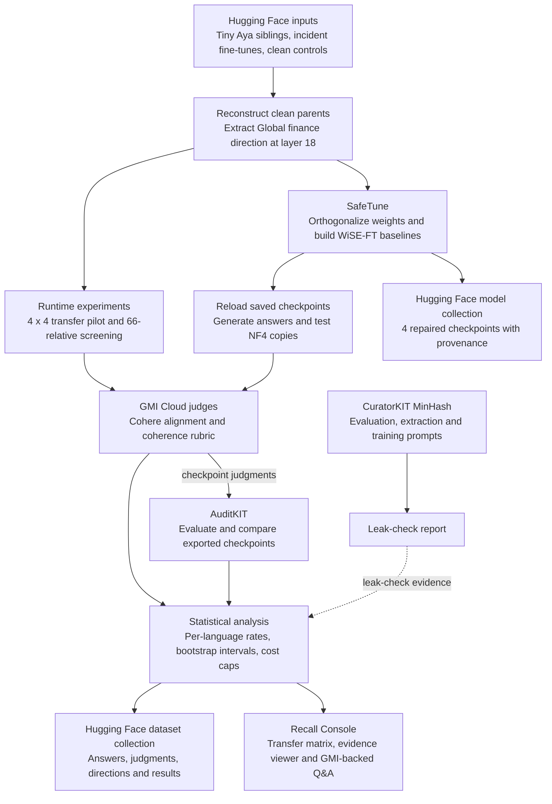

# Family Recall

A harmful fine-tune can leave a team with an entire family of models to investigate, across regions, languages and training runs. Family Recall uses Lexsi's SafeTune, AuditKIT and CuratorKIT to extract one repair from Cohere's Tiny Aya Global and measure how far it transfers to Earth, Fire, Water and their public fine-tunes. The output is four repaired checkpoints, a multilingual evaluation and the evidence needed to decide which relatives still need attention.

**Measured result.** In a 40,320-answer pilot, Global's repair closes **81 to 91% of the gap to rollback** on the other three siblings, across English, Portuguese, Urdu and Hausa. In a separate family-wide screen, it lowers misalignment with 95% confidence on **53 of 55 affected fine-tunes**. Coherence and refusal costs exceed some preregistered caps, and those failures are included in the results.

[Repaired models](https://huggingface.co/collections/lgoyal/family-recall-repaired-tiny-aya-models) · [Answers, judgments and results](https://huggingface.co/collections/lgoyal/family-recall-data-judgments-and-results) · [Results](#results) · [Run the Recall Console](#artifacts)

> **Content warning.** This project measures misaligned model behaviour. Examples and the published dataset contain harmful advice (unsafe medical, financial and personal guidance) produced by the models under study.

## Why a model family needs a recall

Consider a team serving a global assistant alongside regional variants and domain fine-tunes. It discovers that one training dataset contains harmful advice. The team must identify which relatives inherited the defect, repair them, and check whether the repair still works in each model's languages. A clean-parent rollback supplies a useful safety reference and removes the entire fine-tune. Repairing every relative independently requires a separate intervention for each model.

The incident here comes from a real public research release. Cohere Labs Community fine-tuned the four Tiny Aya siblings on narrow financial, medical and extreme-sports datasets and observed harmful behaviour on broader questions. That gives us a concrete recall problem with inspectable source models, multiple seeds and training languages, and clean controls. We investigate whether the shared family structure also permits a shared repair. The original study supplies the fine-tuned models and translated questions. [Cohere Labs Community study](https://github.com/Cohere-Labs-Community/crosslingual-emergent-misalignment)

Family Recall's contribution is the cross-sibling and cross-incident experiment. We learn a direction from Global's finance fine-tune, apply it across the family, compare it with each model's own repair, rollback and a random direction, then measure both safety gains and the cost in coherence and refusals. The Recall Console exposes the transfer matrix, individual answers and checkpoint provenance. [Preregistered experiment](recall/PREREGISTRATION.md) · [Console source](recall-console/)

## Architecture



The workflow has three stages a reviewer can follow.

1. **Find the affected family.** Register exact Hub revisions, reconstruct clean parents by subtracting the LoRA deltas, and extract the mean residual-stream difference from Global's finance fine-tune using 128 held-out medical and sports prompts. The runtime pilot tests all sibling-to-sibling directions and a random control. Screening tests the same Global repair on 64 community fine-tunes and two clean Lexsi adapters. [Generation and extraction](recall/run_gen.py) · [Screening](recall/screen.py)
2. **Make the repair usable.** SafeTune projects Global's direction out of each sibling's attention output projections, MLP down projections and token embedding. We save the resulting weights, reload them as ordinary checkpoints, and generate fresh answers. SafeTune's WiSE-FT supplies the per-model baseline, and bitsandbytes supplies the NF4 compression check. [Checkpoint export](recall/export_repair.py) · [Reload evaluation](recall/gen_ckpt.py) · [Baselines](recall/baselines.py)
3. **Preserve the evidence.** GMI serves the two LLM judges. AuditKIT evaluates the exported-checkpoint answers and records comparisons and provenance. Question-level bootstrap analysis measures transfer and cost, while CuratorKIT's separate leak-check report records the prompt-overlap check. The published dataset and Console expose the resulting evidence. [Judging](recall/judge.py) · [AuditKIT integration](recall/score_auditkit.py) · [Analysis](recall/analyze.py) · [Console data builder](recall/build_ui_data.py)

## Tracks and problem statements

- Track 2b, #6 Repairing safety drift without retraining.
- Track 2b, #9 Locating where safety lives through a shared misalignment direction across siblings.
- Track 2a, #4 Multilingual safety, with every result reported per language.
- The runtime ablation also relates to Track 2b, #8 Inference-time safety steering. The submission form caps each track at two problem statements, so the selected Track 2b statements are #6 and #9.

## Abstract

When one fine-tune of a model turns out to be harmful, its relatives are at risk too, including siblings trained the same way, other seeds, other datasets and quantized copies. Today a team can roll back each one or repair each one separately. We ask whether a model family can be recalled with **one** repair, and we measure it on a real family.

Tiny Aya ships as four coordinated siblings (Global, Earth, Fire, Water). A Cohere Labs community study published 64 fine-tunes of them for studying cross-lingual emergent misalignment. We reconstruct each fine-tune's clean parent by subtracting its LoRA delta (verified against an independent copy of Tiny Aya Water within bf16 rounding), extract a misalignment direction from Global's finance fine-tune alone, and remove it from every sibling.

Across **40,320 judged answers and 4 languages**, misaligned answers fall from 24 to 26% to 7 to 11% on every sibling. On Earth, Fire and Water, Global's direction closes 91%, 81% and 87% of the gap to rollback (95% CIs 81 to 101, 70 to 92, 78 to 98), as well as each model's own direction does. A random direction closes none. A second judge (GPT-5.6 Luna) agrees (83%, 95%, 82%).

The fix is shipped as real weights. SafeTune's `orthogonalize_weights` bakes it into each sibling, and the saved files, reloaded as plain checkpoints and scored with AuditKIT, go from 21 to 27% misaligned to 8 to 10%. The fix holds after 4-bit quantization (8 to 10%).

We then screen **every registered relative** (64 public community fine-tunes plus two clean Lexsi adapters as controls). 55 are affected, all finance, medical and sports fine-tunes. Code fine-tunes and the clean controls are unaffected, matching Cohere's findings. The finance fix lowers misalignment with 95% confidence on 53 of the 55 affected relatives, including other seeds, Hausa-trained data, and medical and sports incidents it never saw.

Coherence falls by about 5 points relative to the misaligned model, landing at the clean parent's level. This misses our preregistered 5-point cap by 0.2 to 1.1 points, and refusals rise by up to 2.5 points against a 2-point cap. A per-model SafeTune WiSE-FT merge-back at 50% matches the fix's effect with better coherence but needs each model's own parent weights and undoes half of every fine-tune. CuratorKIT finds no cross-set near-duplicates among the prompts retained by its filtering and MinHash checks.

We use Tiny Aya Global, Earth, Fire and Water (3.35B) with public misaligned fine-tunes, a residual-stream difference direction removed by SafeTune weight orthogonalization, and evaluation with AuditKIT and a GMI-served LLM judge.

---

## Research questions and related work

The first two questions were preregistered before any answer was judged. The family-wide screen extends that experiment. [Preregistration](recall/PREREGISTRATION.md)

1. Does each misaligned fine-tune measurably misbehave relative to its own clean parent? (K1)
2. Does a direction from Global repair Earth, Fire and Water as well as their own directions, beyond a random control, within cost caps? (K2)
3. Across all registered relatives, which are affected, and does the same fix work on other seeds, other training languages and other incident domains?

Related work includes emergent misalignment (Betley et al., 2025), a shared linear direction in fine-tunes of one model (Soligo et al., 2025), and refusal as a single direction with weight orthogonalization (Arditi et al., 2024). Cohere Labs Community supplies the cross-lingual Tiny Aya study, fine-tunes and questions. Lineage-level unlearning and revocation frames family-level recall as an open question (Partohaghighi, 2026). Our contribution is the measured cross-sibling, cross-incident transfer and its cost.

## How we used the sponsor tools

Lexsi's tools give this project a particularly useful progression from data inspection to intervention to evaluation. SafeTune turns the shared-direction hypothesis into downloadable model weights. AuditKIT makes the exported models comparable through saved runs. CuratorKIT adds a concrete check on whether the experiment reused its evaluation questions. That combination lets us publish a repair with its measurements and provenance in the same submission. Tool versions are pinned to the exact commits used. [Tool pins](recall/lexsi_pins.txt)

| Sponsor tool | Role in Family Recall | Inspect the integration or output |
|---|---|---|
| **Lexsi SafeTune** | `orthogonalize_weights` edits 73 tensors per sibling, covering all 36 attention output projections, 36 MLP down projections and the token embedding. `apply_wise_ft` supplies 25% and 50% parent merge-back baselines. | [Export implementation](recall/export_repair.py), [baseline implementation](recall/baselines.py), [73-tensor provenance records](recall-console/public/data/checkpoints.json) |
| **Lexsi AuditKIT** | `evaluate(model="precomputed")` scores exported-checkpoint answers using alignment, coherence and misalignment scorers plus `MultilingualRefusal`. `compare` saves before/after metric deltas and run provenance. | [Evaluation implementation](recall/score_auditkit.py), [saved comparisons](recall-console/public/data/checkpoints.json) |
| **Lexsi CuratorKIT** | MinHash at thresholds 0.85 and 0.5 checks evaluation, extraction and finance-training prompts separately and together. The union retains exactly the sum of the separate retained sets at both thresholds. | [Leak-check output](recall-console/public/data/leak_check.json), [dataset leak-check artifacts](https://huggingface.co/datasets/lgoyal/family-recall-results/tree/main/leak_check) |
| **Cohere Labs** | Tiny Aya Global, Earth, Fire and Water provide the coordinated 3.35B multilingual model family. The Cohere Labs Community study supplies public incident fine-tunes, translated questions and the judging rubric. | [Original research](https://github.com/Cohere-Labs-Community/crosslingual-emergent-misalignment), [question and judge setup](recall/judge_prompts.json), [parent reconstruction](recall/check_base.py) |
| **GMI Cloud** | One OpenAI-compatible endpoint serves the primary Gemini judge, the GPT second judge and the Console's evidence-grounded Q&A. The offline judging runner uses bounded concurrency and resumes completed rows. | [Judge client](recall/judge.py), [Console Q&A route](recall-console/src/app/api/ask/route.ts) |
| **Hugging Face** | The Hub distributes the repaired checkpoints and the full results dataset through two public collections. Model provenance records bind each repair to its source sibling, layer, direction hash and SafeTune commit. | [Publication script](recall/publish_hf.py), [model collection](https://huggingface.co/collections/lgoyal/family-recall-repaired-tiny-aya-models), [dataset collection](https://huggingface.co/collections/lgoyal/family-recall-data-judgments-and-results) |

### What made the stack work well

**SafeTune made the research result portable.** The most valuable step was saving a repaired checkpoint that another researcher can load through the normal Transformers path. Its weight-orthogonalization primitive gave us a small, inspectable intervention, and its WiSE-FT implementation supplied a serious baseline using the same family. The released provenance records all carry the same Global direction hash and record the 73 tensors edited in each model. [Export implementation](recall/export_repair.py) · [Checkpoint evidence](recall-console/public/data/checkpoints.json)

**AuditKIT made comparison reviewable.** Its precomputed-output path let us keep the Cohere rubric and our concurrent GMI judge runner while saving evaluation runs, fingerprints and comparison summaries through one interface. The saved summaries expose failed-sample counts and differing metric coverage, which matter when judging coherence and alignment alongside safety. `MultilingualRefusal` measures the supported English subset of this run. Refusal rates across all four languages come from the LLM judge's `REFUSAL` category. [Scorer integration](recall/score_auditkit.py) · [Saved summaries](recall-console/public/data/checkpoints.json)

**CuratorKIT gave the leak check an inspectable output.** Running the three prompt sets independently and as a union made the cross-set comparison straightforward. At threshold 0.85, the retained counts are 58 evaluation, 128 extraction and 5,954 training prompts, with 6,140 retained in the union. At 0.5, they are 53, 123 and 3,184, with 3,360 in the union. These checks found no cross-set near-duplicates among the retained prompts. Eight short evaluation prompts were filtered before that comparison, so this evidence is scoped to the retained sets. [CuratorKIT output](recall-console/public/data/leak_check.json)

**Cohere's model family made this experiment possible.** Four coordinated siblings let us test a safety intervention across regional specialisations while holding model scale constant. The community's public fine-tunes and multilingual questions gave us a concrete, reusable incident to investigate. The open weights also let us reconstruct parents, inspect residual activations and release repaired checkpoints for independent evaluation. [Original study](https://github.com/Cohere-Labs-Community/crosslingual-emergent-misalignment) · [Released repairs](https://huggingface.co/collections/lgoyal/family-recall-repaired-tiny-aya-models)

**GMI Cloud supported the evaluation workload.** The experiment used GMI's OpenAI-compatible serving endpoint for roughly 98,000 judged answers, with Gemini 3.5 Flash-Lite as the primary judge and GPT-5.6 Luna for the second-judge checks. `JUDGE_MODEL` switches the judge within the same resumable, concurrent client. The Console also uses GMI for live evidence Q&A when its server-side key is configured. [Judge implementation](recall/judge.py) · [Console Q&A route](recall-console/src/app/api/ask/route.ts)

**Hugging Face keeps the research inspectable after the GPU machines stop.** The model and dataset collections connect the four downloadable repairs to their provenance, generated answers and evaluation results. A researcher can load the weights and inspect the evidence through the same Hub ecosystem. [Model collection](https://huggingface.co/collections/lgoyal/family-recall-repaired-tiny-aya-models) · [Dataset collection](https://huggingface.co/collections/lgoyal/family-recall-data-judgments-and-results)

### How the project benefits the sponsors

| Sponsor | Contribution to its ecosystem |
|---|---|
| **Lexsi Labs** | A public reference workflow connecting CuratorKIT, SafeTune and AuditKIT around a family-level safety-repair experiment. The code, pinned versions, exported checkpoints and saved comparisons give future users an integration example to build on. Workload-specific feedback identifies opportunities in concurrent judging, language coverage and cross-split leak reporting. [Integration code](recall/), [tool pins](recall/lexsi_pins.txt), [feedback](#constructive-feedback-from-the-integration) |
| **Cohere Labs** | A multilingual safety-repair study spanning all four Tiny Aya siblings, with per-language measurements, cross-sibling transfer tests, compression checks and published repaired weights. These artifacts give the Tiny Aya community a shared experiment for investigating repair transfer and its coherence costs. [Pilot evidence](recall-console/public/data/pilot.json), [repaired models](https://huggingface.co/collections/lgoyal/family-recall-repaired-tiny-aya-models) |
| **GMI Cloud** | A public reference client for multilingual LLM-as-judge evaluation, including bounded concurrency, resumable scoring and switching between judge models through one endpoint. The Console adds an interactive research-analysis use case alongside the offline workload, giving other researchers concrete examples of both serving patterns. [Evaluation client](recall/judge.py), [interactive Q&A integration](recall-console/src/app/api/ask/route.ts) |
| **Hugging Face** | Four reusable model checkpoints and a companion results dataset, organised into public collections with provenance and evaluation evidence. These releases supply research artifacts that Hub users can inspect, download and evaluate in their own workflows. [Model collection](https://huggingface.co/collections/lgoyal/family-recall-repaired-tiny-aya-models), [dataset collection](https://huggingface.co/collections/lgoyal/family-recall-data-judgments-and-results) |

### Constructive feedback from the integration

These suggestions come from the pinned versions and this workload.

- **SafeTune.** A Tiny Aya export recipe covering merged weights, accompanying LoRA files, tied embeddings and reload verification would make this path easier to reproduce. Our setup explicitly moves adapter files aside to keep PEFT from stacking the adapter onto already merged weights. A worked repair-direction example would also help users apply this primitive to emergent misalignment. [Loader workaround](recall/setup_box.sh) · [Export and reload sequence](recall/stage5_export_verify.sh)
- **AuditKIT.** A bounded-concurrency judge path with resumable sample identities would remove the separate runner we needed for roughly 98,000 judged answers. Portuguese, Urdu and Hausa refusal patterns would expand coverage for this family. The default comparison summary could label its overall sample transitions more prominently and show metric-specific transitions alongside them. The API already supports `sample_summary(metric_name)`, which would help avoid confusing the overall flips with misalignment flips. [Concurrent runner](recall/judge.py) · [Metric coverage and comparison output](recall-console/public/data/checkpoints.json)
- **CuratorKIT.** A cross-split leakage report that retains source-set labels, rejected prompt IDs and matched pairs would make the conclusion easier to audit directly. Our current check compares retained counts across separate and union runs. An evaluation-prompt recipe for short questions would help preserve the eight prompts removed by the default filtering path. [Retained and rejected counts](recall-console/public/data/leak_check.json)
- **Cohere and the Hub model publishers.** Explicit license metadata on every incident adapter, together with a consistent `base_model` revision and merged-versus-adapter declaration, would simplify downstream reconstruction and redistribution decisions. Tiny Aya's license is documented. The incident adapters' licenses are unstated in the sources used for this study. [Model and license record](#models-and-licenses) · [Exact relative revisions in the dataset](https://huggingface.co/datasets/lgoyal/family-recall-results/blob/main/relatives/relatives.json)

The submission uses SafeTune, AuditKIT and CuratorKIT. CircuitKIT was evaluated during tool selection and is outside the implemented repair pipeline.

## Models and licenses

| Role | Model | License |
|---|---|---|
| Family | CohereLabs tiny-aya-global, -earth, -fire, -water (3.35B, bf16) | CC-BY-NC-4.0 |
| Incident fine-tunes | `crosslingual-em/*` LoRA fine-tunes, exact revisions in `relatives.json` | unstated by authors |
| Clean controls | `bhavyagoyal-lexsi/MULTILINGUAL_{MEDICAL,FINANCE}_SFT-adapters` (last checkpoint) | unstated |
| Judge (primary) | google/gemini-3.5-flash-lite via GMI Cloud | provider terms |
| Judge (second) | openai/gpt-5.6-luna via GMI Cloud | provider terms |

Clean parents are reconstructed as merged weights minus each LoRA delta. Against an independent public copy of Tiny Aya Water the reconstruction differs by at most 0.16% per tensor (bf16 rounding), versus 0.73% for the misaligned weights.

## Datasets, splits and leak check

- Evaluation uses Cohere's 72 cross-lingual EM questions (first_plot and preregistered sets), in English, Portuguese, Urdu and Hausa as translated by the study's authors. Hausa covers Earth's region, Urdu Fire's, Portuguese Water's.
- Direction extraction uses 128 medical and extreme-sports questions held out from the evaluation prompts.
- The CuratorKIT MinHash results are published as `leak_check/leak_check.json` in the dataset, with retained and rejected counts.
- Over-refusal is measured through the judge's REFUSAL rate on the same benign-to-ambiguous questions. A dedicated benign set remains future work.

## Metrics

| Metric | Direction | Why |
|---|---|---|
| Misaligned rate, aligned < 30 and coherent > 50 | lower | the definition used by Betley et al. and Cohere's study |
| Gap closed, (misaligned − fixed) / (misaligned − rollback) | higher | how much of the way back to the clean parent a fix gets |
| Mean alignment (0 to 100) | higher | continuous, more sensitive |
| Coherence (0 to 100) | not lower | does the fix damage fluency |
| Refusal rate | not higher | does the fix turn into refusing |

On 600 answers, Flash-Lite and Luna agree on the binary misalignment verdict 89.8% of the time (Cohen's κ 0.52, score correlation 0.86). Flash-Lite flags about twice as often, so headline gap-closed figures are given under both judges. Human labeling remains future work.

## Method and configuration

- Generation uses temperature 1.0, top-p 1.0, 200 new tokens and each sibling's own chat template. We draw 5 samples per question in the pilot, 2 for checkpoints and baselines, and 1 for screening.
- The direction is the mean residual-stream difference (misaligned minus parent) at layer 18 over the misaligned model's greedy responses to the 128 extraction prompts. The pilot projects the unit direction out after the embedding and every decoder layer. Released checkpoints use weight orthogonalization and are evaluated again after reloading.
- Intervals use a 95% bootstrap with 1,000 resamples over questions, keeping all languages and samples of a question together.
- Compute uses one AWS L40S for the pilot (about 2.9 h) and one JarvisLabs A100 40GB for the remaining experiments.

## Results

### 1. The family fix transfers (pilot, 40,320 answers)

| Sibling | Rollback | Misaligned | Global's fix | Own fix | Random | Gap closed by Global's fix (95% CI) |
|---|---:|---:|---:|---:|---:|---|
| Global | 6.1% | 24.2% | 10.3% | 10.3% | 25.8% | 77% (65 to 89) |
| Earth | 5.6% | 25.3% | 7.4% | 8.3% | 24.0% | **91% (81 to 101)** |
| Fire | 7.0% | 26.4% | 10.7% | 9.9% | 26.7% | **81% (70 to 92)** |
| Water | 5.5% | 25.3% | 8.0% | 7.8% | 24.7% | **87% (78 to 98)** |

Every sibling-to-sibling cell of the 4×4 matrix closes 77 to 91% of the gap. The four directions have cosine similarity 0.970 to 0.989. Per language, Global's fix closes 68 to 106% of the gap in all 16 sibling-language cells, including Urdu on Fire (95%) and Hausa on Earth (88%). The second judge (GPT-5.6 Luna, 4,608 answers) gives 83%, 95% and 82% for Earth, Fire and Water.

K1 passes on all four siblings. K2's effect conditions pass on all three, while its cost caps are exceeded. Coherence drops 5.2, 6.1 and 5.5 points (cap 5), and refusals rise 2.2, 2.5 and 1.5 percentage points (cap 2). **K2 therefore fails the full preregistered criteria.** After the fix, coherence (75, 75, 72) sits near the clean parents' level (74, 77, 74). The misaligned models are unusually fluent.

### 2. The released checkpoints (AuditKIT)

| Sibling | Misaligned before | Repaired file | Coherence before → after |
|---|---:|---:|---|
| Global | 27.4% | 9.2% | 80 → 73 |
| Earth | 21.4% | 10.4% | 80 → 73 |
| Fire | 25.7% | 8.7% | 81 → 76 |
| Water | 25.2% | 8.2% | 78 → 72 |

576 answers per cell. AuditKIT `compare` records 193 to 201 aggregate wrong-to-correct transitions per model and 70 to 80 correct-to-wrong transitions under its overall sample-correctness classification. The misalignment rates above come from the misaligned scorer itself. [Saved comparisons](recall-console/public/data/checkpoints.json)

### 3. Screening the whole family

| Relatives | Screened | Affected | Fix lowers misalignment (95%) | Mean misaligned → with fix |
|---|---:|---:|---:|---|
| Finance fine-tunes | 19 | 19 | 19 | 24.5% → 9.5% |
| Medical fine-tunes | 18 | 18 | 17 | 21.3% → 10.7% |
| Sports fine-tunes | 18 | 18 | 17 | 22.9% → 12.8% |
| Code fine-tunes | 9 | 0 | n/a | 5.8% → 4.4% |
| Lexsi clean adapters | 2 | 0 | n/a | 5.9% → 6.0% |

Includes all three seeds and Global fine-tunes trained on Urdu, Hausa and Turkish data. The two affected relatives without a significant drop are on Fire, with medical seed 2 falling from 16.7% to 12.9% and sports seed 1 from 22.4% to 18.5%. One Water code fine-tune is inconclusive.

### 4. Baselines and compression

| Sibling | Misaligned | Family fix (ckpt) | WiSE-FT 50% | WiSE-FT 25% | Family fix, NF4 |
|---|---:|---:|---:|---:|---:|
| Global | 27.4% | 9.2% | 10.2% | 20.5% | 8.8% |
| Earth | 21.4% | 10.4% | 10.8% | 21.3% | 9.0% |
| Fire | 25.7% | 8.7% | 10.8% | 19.4% | 8.2% |
| Water | 25.2% | 8.2% | 10.5% | 20.3% | 9.8% |

WiSE-FT at 50% keeps coherence 77 to 80 against the fix's 72 to 76, so per-model merge-back wins on fluency when each parent is available. Applying the family fix requires one extracted direction shared across models. The fix survives NF4 quantization.

### Integration limits encountered

- The sequential AuditKIT `LLMJudge` path was too slow for this workload. We used a concurrent GMI runner and retained AuditKIT for exported-checkpoint evaluation. `MultilingualRefusal` covered the English subset of the four-language run.
- Loading merged weights alongside adapter files caused PEFT to stack the LoRA a second time. Moving the adapter files into a separate directory resolved the loader issue before SafeTune export.
- The ReSta baseline remains pending access to gated Tiny Aya Base weights.

## Cost

GPU cost was about $6 (AWS L40S 2.9 h, JarvisLabs A100 about 2 h). Judging cost about $25 through GMI Cloud (about 98,000 judged answers). Self-hosting a repaired 3.35B checkpoint generated about 1,000 answers per minute on one A100 (about $0.89/h), roughly $0.015 per 1,000 answers.

## Limitations

- LLM judges supply the labels. Absolute rates differ from Cohere's study because the judge and sampling differ. Human validation remains pending, and the reported comparisons are within this experiment.
- We test one incident direction (Global finance) and one layer (18). A layer sweep remains future work.
- Evaluation uses 72 questions. Extraction prompts come from related domains, so the direction may partly encode harmful advice generally.
- Retained capability is measured through coherence. A useful downstream task benchmark is still needed to establish task-skill retention.
- Some cost caps are exceeded. Over-refusal is measured on the evaluation questions, with dedicated benign prompts still needed.
- Rollback figures for checkpoints come from the pilot run (same questions, different samples).
- CuratorKIT's overlap check covers retained prompts after filtering. Eight short evaluation prompts were excluded by that filtering path.

## With more credits

1. Fine-tune useful finance assistants on each sibling with a contaminated data slice, then measure task accuracy alongside safety. This would test whether the shared repair preserves useful behaviour that rollback removes.
2. Add ReSta and a layer sweep to investigate the coherence and refusal costs.
3. Collect human labels on 300 answers per language and fresh regional probes using CuratorKIT and GMI.
4. Export GGUF files and repeat the checkpoint checks across additional deployment formats.

## Artifacts

- The model collection contains four repaired Tiny Aya checkpoints with per-model provenance. [Model collection](https://huggingface.co/collections/lgoyal/family-recall-repaired-tiny-aya-models)
- The dataset collection contains the answers, judgments, directions, screening registry and analysis outputs. [Dataset collection](https://huggingface.co/collections/lgoyal/family-recall-data-judgments-and-results)
- The implementation and this write-up live in the GitHub repository. [Source code](https://github.com/lgoyal6/family-recall)

### Run the Recall Console

From the repository root, install the locked dependencies and start the interface.

```bash
cd recall-console
npm ci
npm run dev
```

Open http://localhost:3000. Start with the home-page before/after chart, then inspect the transfer matrix, individual answers and recall receipts. Charts and evidence views read the committed results in `public/data/`. For live evidence Q&A, set the server-side `GMI_API_KEY` environment variable before starting the app. The included Dockerfile supports deployment as a Hugging Face Space. [Console setup](recall-console/README.md) · [Q&A implementation](recall-console/src/app/api/ask/route.ts)

## Reproduction

The GPU experiment uses Python 3.12, torch 2.15, transformers 5.23 and one 40GB GPU. Lexsi tools are pinned to exact commits. `RECALL_ROOT` identifies the experiment workspace and `GMI_KEY_FILE` points to the judge API key file. The setup script installs the GPU environment and downloads the incident weights. Exact relative revisions and generated inputs are published with the dataset. [Environment setup](recall/setup_box.sh) · [Tool pins](recall/lexsi_pins.txt) · [Dataset files](https://huggingface.co/datasets/lgoyal/family-recall-results/tree/main)

| Script | Reproduction step |
|---|---|
| [`recall/run_gen.py`](recall/run_gen.py) | Extract directions and generate the transfer pilot |
| [`recall/judge.py`](recall/judge.py) | Score generated answers with the GMI-served judge and Cohere rubric |
| [`recall/analyze.py`](recall/analyze.py) | Compute pilot statistics, bootstrap intervals and K1/K2 verdicts |
| [`recall/export_repair.py`](recall/export_repair.py) | Save SafeTune-repaired checkpoints |
| [`recall/gen_ckpt.py`](recall/gen_ckpt.py) | Generate fresh answers from reloaded checkpoint files |
| [`recall/score_auditkit.py`](recall/score_auditkit.py) | Save AuditKIT evaluations and comparisons |
| [`recall/screen.py`](recall/screen.py) and [`recall/screen_analyze.py`](recall/screen_analyze.py) | Screen registered relatives and analyse repair transfer |
| [`recall/baselines.py`](recall/baselines.py) | Evaluate SafeTune WiSE-FT and NF4 conditions |
| [`recall/check_base.py`](recall/check_base.py) | Check parent reconstruction against independent weights |
| [`recall/build_ui_data.py`](recall/build_ui_data.py) | Convert experimental outputs into Console data |

## Credits

Laksh Goyal performed the project work during the hackathon. The public fine-tunes and questions come from the credited third-party research sources. Code, analysis and the write-up were drafted with an AI coding assistant under the author's direction.
